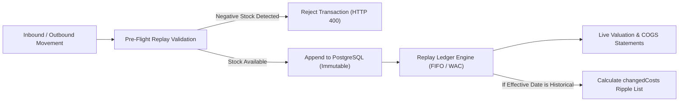
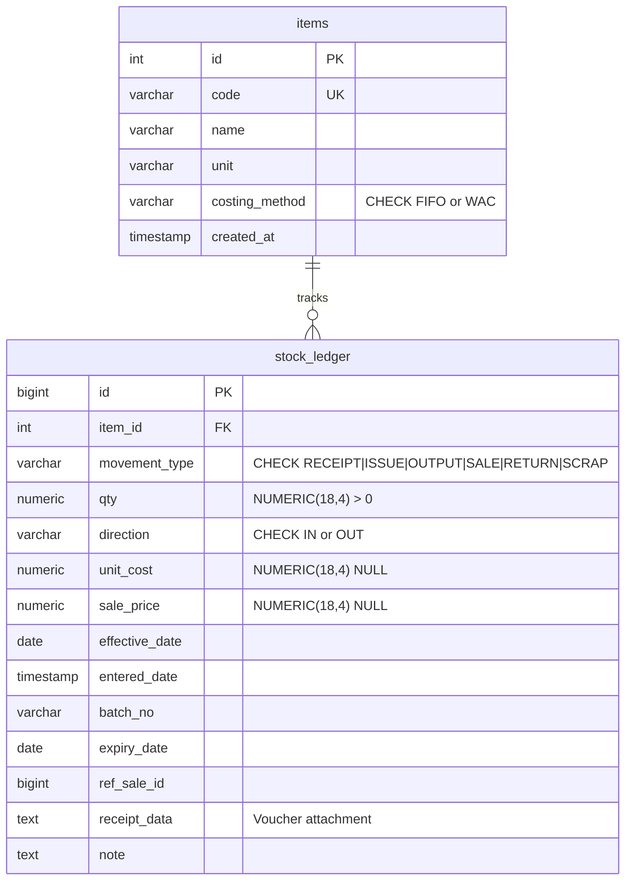

# The Digital Ledger Book — Stock Management & Inventory Valuation Engine

[](https://nodejs.org/)
[](https://react.dev/)
[](https://www.postgresql.org/)
[]()
[-orange.svg)]()
[]()

> A production-grade inventory valuation and stock ledger engine designed according to GAAP/IFRS inventory accounting standards. Engineered with a **strictly append-only immutable ledger**, **deterministic FIFO and Weighted Average Costing (WAC) replay**, **backdated movement historical ripple adjustment**, and a custom-crafted **"Digital Ledger Book"** frontend interface.

---

## 📑 Table of Contents
1. [Executive Summary & Core Principles](#executive-summary--core-principles)
2. [Architectural Highlights & Constraints](#architectural-highlights--constraints)
3. [Costing Engine & Mathematical Mechanics](#costing-engine--mathematical-mechanics)
   - [FIFO (First-In, First-Out) Layer Consumption](#1-fifo-first-in-first-out-layer-consumption)
   - [WAC (Weighted Average Cost) Continuous Pooling](#2-wac-weighted-average-cost-continuous-pooling)
   - [Exact Sales Return Valuation (`ref_sale_id`)](#3-exact-sales-return-valuation-ref_sale_id)
   - [Retroactive Replay & Ripple Banner (`changedCosts`)](#4-retroactive-replay--ripple-banner-changedcosts)
4. [Database Schema & Data Integrity](#database-schema--data-integrity)
   - [Append-Only PostgreSQL Enforcement Trigger](#append-only-postgresql-enforcement-trigger)
   - [Optimized Replay Indexing](#optimized-replay-indexing)
5. [Frontend Design Concept: The Digital Ledger Book](#frontend-design-concept-the-digital-ledger-book)
   - [Signature Features](#signature-features)
   - [Voucher & Receipt Document Upload](#voucher--receipt-document-upload)
6. [API Specification & Endpoints](#api-specification--endpoints)
7. [Automated Verification & Test Suite](#automated-verification--test-suite)
8. [Installation & Quickstart Guide](#installation--quickstart-guide)

---

## 🏛 Executive Summary & Core Principles

In traditional ERP databases, inventory stock balances and outgoing costs are frequently calculated via destructive row mutations or stored statically. This leads to database drift, inability to audit historical states, and catastrophic discrepancies when backdated inventory receipts arrive.

This application solves these systemic flaws through three primary architectural decisions:
1. **Immutable Ledger (Write-Only / Append-Only)**: The `stock_ledger` table strictly forbids SQL `UPDATE` and `DELETE` operations via a PostgreSQL database trigger. Every state change is an explicit, immutable debit or credit movement.
2. **Deterministic Dynamic Costing Replay**: Outgoing movement unit costs and valuations are never statically stored. They are computed on-the-fly by replaying the ledger in strict `(effective_date ASC, id ASC)` sequence.
3. **Internal 4-Decimal Arithmetic (`NUMERIC(18,4)`)**: Prevents IEEE 754 floating-point drift across iterative divisions. Values round strictly at the display boundary to 2 decimal places.



---

## ⚡ Architectural Highlights & Constraints

* **Zero Bloat / Minimal Dependencies**:
  * **Frontend**: Plain React 18 with Vite, React Router 6, and hand-crafted CSS variables. **Zero external UI kits** (no Material-UI, Tailwind, or AntD) and **zero charting libraries**.
  * **Backend**: Pure Node.js and Express with plain JavaScript. Zero heavy ORMs (no Prisma, Sequelize, or TypeORM); uses standard connection pooling via the official `pg` library.
* **Separation of Concerns**: The costing engine (`server/src/costing.js`) is an isolated, 100% pure function module without any network, file, or database dependencies.
* **Temporal Dual-Date Architecture**:
  * `effective_date`: Calendar date when the stock physically arrived or was consumed.
  * `entered_date`: Timestamp (`DEFAULT NOW()`) marking when the ledger row was inscribed.

---

## 🧮 Costing Engine & Mathematical Mechanics

### 1. FIFO (First-In, First-Out) Layer Consumption
Incoming receipts (`RECEIPT`, `PRODUCTION_OUTPUT`) append discrete cost layers `[{ qty, cost }]`. Outgoing dispatches (`SALE`, `ISSUE_PRODUCTION`, `SCRAP`) systematically consume the oldest available layers.

When an outbound issue spans multiple layers, the unit cost is computed as the exact weighted average of all consumed slices:
$$\text{Line Value} = \sum_{i=1}^{k} (\Delta q_i \times c_i)$$
$$\text{Unit Cost} = \frac{\text{Line Value}}{\text{Quantity}}$$

### 2. WAC (Weighted Average Cost) Continuous Pooling
For WAC inventory, every incoming movement dynamically recalculates the continuous running average:
$$\text{New Running Cost} = \text{round}_4 \left( \frac{\text{Prior Value} + (\text{Qty}_{\text{in}} \times \text{Cost}_{\text{in}})}{\text{Prior Qty} + \text{Qty}_{\text{in}}} \right)$$
Outgoing movements immediately deplete stock at the current running average without altering the per-unit pool rate.

### 3. Exact Sales Return Valuation (`ref_sale_id`)
When a customer returns items (`SALES_RETURN`), standard accounting dictates the goods must re-enter inventory at the **exact original cost assigned when that sale was dispatched**, rather than today's prevailing replacement price. The engine locates the original sale via `ref_sale_id` and restores inventory layers at that exact historical cost.

### 4. Retroactive Replay & Ripple Banner (`changedCosts`)
When an invoice is entered late (e.g., effective on Oct 5th, but entered on Oct 12th after subsequent sales on Oct 10th):
1. The engine executes a **pre-entry baseline replay**.
2. It executes a **post-entry replay** incorporating the historical movement.
3. If stock would turn negative at any point in the timeline, the request is immediately aborted before database insertion.
4. If approved, the server returns a `changedCosts` list (`{ id, old_cost, new_cost, difference }`).
5. The frontend displays the **Stamp-Red Ripple Banner** and visibly highlights all affected downstream rows with red margin marks.

---

## 🗄 Database Schema & Data Integrity



### Append-Only PostgreSQL Enforcement Trigger
To prevent manual tampering or accidental administrative modification, the database schema includes a strict PL/pgSQL trigger:

```sql
CREATE OR REPLACE FUNCTION prevent_stock_ledger_mutation()
RETURNS TRIGGER AS $$
BEGIN
    RAISE EXCEPTION 'stock_ledger is append-only: UPDATE and DELETE operations are forbidden.';
END;
$$ LANGUAGE plpgsql;

CREATE TRIGGER trg_prevent_stock_ledger_mutation
BEFORE UPDATE OR DELETE ON stock_ledger
FOR EACH ROW EXECUTE FUNCTION prevent_stock_ledger_mutation();
```

### Optimized Replay Indexing
Chronological replay requires streaming an item's movements in timeline order. The database is indexed specifically for this query path:
```sql
CREATE INDEX idx_stock_ledger_item_effective_id 
ON stock_ledger (item_id, effective_date, id);
```

---

## 🎨 Frontend Design Concept: "The Digital Ledger Book"

The application rejects generic corporate dashboard cards in favor of a tactile, bookkeeper-inspired aesthetic:
* **Paper Canvas & Ink Contrast**: Warm parchment off-white (`#f6f1e7`), ink-dark typography (`#1d1b16`), and subtle CSS-only procedural paper grain.
* **Typographic Hierarchy**:
  * Headings: **Fraunces** (antique editorial serif).
  * UI Labels & Body: **Inter** (clean sans).
  * Quantities & Monies: **IBM Plex Mono** with tabular numeric lining so decimal points align vertically in tables.
* **Rubber-Stamp Status Badges**: Movement types are displayed as slightly tilted rubber stamps (`RECEIPT`, `ISSUE`, `OUTPUT`, `SALE`, `RETURN`, `SCRAP`) with unique vintage ink tones.
* **Book Spine Navigation**: Narrow antique dark leather binding on the left with gold-embossed Roman numerals (`I. Ledger`, `II. Add Entry`, `III. Items`, `IV. Statements`).

### Signature Features
1. **Adaptive Entry Form**: Choosing the movement nature first adapts the form fields (cost for receipts, price for sales, batch/expiry for purchases, and prior sale picker for returns).
2. **Live Projected Balance Preview**: Calculates live balance before submission:
   `"After this entry: STEEL balance 90.00 KG, value $4,950.00"`.
3. **Cost Layer Stack**: Visual stack of bars on each item's page demonstrating FIFO layers being shaved by issues or a WAC continuous running average line.
4. **Expiry Timeline Strip**: Horizontal timeline of lots with dynamic countdown chips (Green $\rightarrow$ Amber $< 30$ days $\rightarrow$ Red expired) and a single-click write-off dialog.
5. **Month-End Closing Statement**: Formatted printable statement showing the audit reconciliation formula:
   $$\text{Opening Value} + \text{Receipts} - \text{Issues} - \text{Sales Cost} - \text{Scrap} = \text{Closing Value}$$
6. **Voucher & Receipt Document Upload**:
   - File dropzone in `Add Entry` supporting PNG, JPG, and PDF invoices up to 15 MB.
   - Converts vouchers into portable data payloads stored in the ledger.
   - Clickable `🧾 View Receipt` modal viewer on ledger rows allowing full inspection and voucher downloading.

---

## 📡 API Specification & Endpoints

| Method | Endpoint | Description |
|---|---|---|
| `GET` | `/health` | Verifies Express server and PostgreSQL pool connectivity |
| `GET` | `/items` | Returns catalog of inventory items and costing methods |
| `POST` | `/items` | Registers a new item (`code`, `name`, `unit`, `costing_method`) |
| `GET` | `/movements` | Fetches movements with dynamic FIFO/WAC replay costs and running balances |
| `POST` | `/movements` | Simulates and affixes a new ledger row; returns `changedCosts` if backdated |
| `GET` | `/reports/valuation?asOf=` | Computes total inventory valuation and item balances as of any date |
| `GET` | `/reports/cogs?from=&to=` | Calculates Period Revenue, COGS, Gross Margin, and margin percentage |
| `POST` | `/expiry/writeoff?asOf=` | Identifies expired batches and creates `SCRAP` entries (idempotent, no duplicates) |

---

## 🧪 Automated Verification & Test Suite

The test suite runs via Jest and verifies mathematical rigor across both isolated unit tests and a multi-item enterprise seed ledger:

```text
 PASS  tests/costing.test.js
 PASS  tests/seed.test.js

Test Suites: 2 passed, 2 total
Tests:       19 passed, 19 total
Snapshots:   0 total
Time:        2.888 s
```

### The 8 Core Financial Assertions
Every continuous deployment test automatically checks the following 8 accounting benchmarks:
1. **STEEL Late Receipt Adjustment**: 10-Oct production issue costs exactly **\$6,040.00** after retroactive receipt (would be \$6,100.00 without it; exact difference of **-\$60.00**).
2. **PAINT WAC Valuation**: Closes at **100 L** worth exactly **\$1,175.00** (WAC @ \$11.7500/L).
3. **CHAIR Sales Return**: 10 returned chairs re-enter inventory valued at the exact original sale cost of **\$1,227.27**.
4. **Perishable ADHESIVE Write-off**: Expired batch `ADH-01` scrapped for **\$400.00**.
5. **Total Inventory Stock Value**: Combined inventory valuation equals exactly **\$22,959.55**.
6. **Period COGS & Revenue**: Net Cost of Goods Sold evaluates to **\$19,418.18**.
7. **Reconciliation Invariance**: $\text{Value In} - \text{Value Out} = \text{Closing Value}$ with **0.00 variance**.
8. **Chronological Order Invariance**: Shuffling row submission order yields **identical mathematical output**.

---

## 🚀 Installation & Quickstart Guide

### Prerequisites
* [Node.js](https://nodejs.org/) (v18.0.0 or higher)
* [PostgreSQL](https://www.postgresql.org/) (v14 or higher)

### 1. Database Setup
Create your PostgreSQL database:
```sql
CREATE DATABASE stock_management;
```

### 2. Backend Configuration (`server/`)
```bash
cd server

# Copy environment configuration
cp .env.example .env

# Configure your PostgreSQL credentials in .env:
# PORT=5000
# PGHOST=localhost
# PGPORT=5432
# PGDATABASE=stock_management
# PGUSER=postgres
# PGPASSWORD=your_password

# Install dependencies
npm install

# Initialize schema and seed sample data
npm run init-db

# Run automated test suite
npm test

# Start Express server with auto-reload
npm run dev
```
*Backend runs at `http://localhost:5000`.*

### 3. Frontend Setup (`client/`)
```bash
cd ../client

# Install dependencies
npm install

# Start Vite development server
npm run dev
```
*Frontend runs at `http://localhost:3000` (API calls automatically proxied to `:5000`).*

---

## 👩‍💻 Author & Engineering Credits
* **Developer**: Induja S
* **GitHub Repository**: [Induja-2103/Stock_management](https://github.com/Induja-2103/Stock_management.git)
* **Design Philosophy**: The Digital Ledger Book (Immutable Double-Entry Style Architecture)
